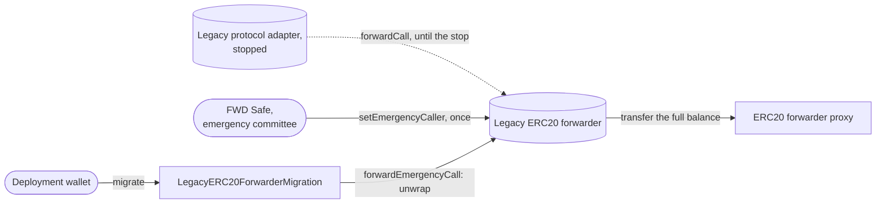
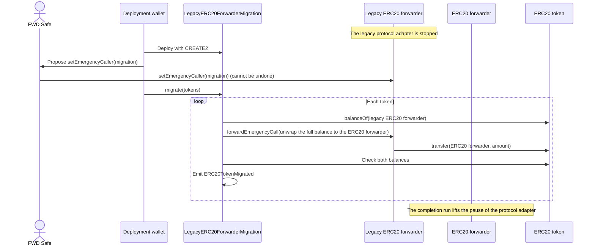

# Asset Migration — Specification & Architecture

This document specifies the asset migration: the one-time move of the tokens of a chain's legacy ERC20 forwarder, an immutable contract, to the ERC20 forwarder, an upgradeable proxy. It gives the order of the steps and the reasons for it. The domain vocabulary is in [`CONTEXT.md`](../CONTEXT.md), and the commands are in [`MIGRATION_CHECKLIST.md`](../MIGRATION_CHECKLIST.md). The protocol adapter's part of the same move, the state migration, is in pa-evm's [`01-state-migration.md`](https://github.com/anoma/pa-evm/blob/next/docs/01-state-migration.md). Every later change of the ERC20 forwarder is an upgrade, which [`02-upgrades.md`](./02-upgrades.md) specifies. The forwarder's part of a hard migration is in [`03-hard-migration.md`](./03-hard-migration.md).

## 1. Purpose

The legacy ERC20 forwarder holds the tokens behind every legacy-forwarder resource. It accepts calls only from the legacy protocol adapter. The state migration stops the legacy protocol adapter, and nothing restarts it. The protocol adapter cannot call the legacy ERC20 forwarder. So the tokens move to the ERC20 forwarder, and the kind table lets each legacy-forwarder resource convert and unwrap there.

The asset migration is the only change of a chain's ERC20 forwarder that is not an upgrade, and it happens once. A chain cannot go back, because the legacy ERC20 forwarder keeps the emergency caller that the asset migration assigns. After the asset migration, each change of the ERC20 forwarder is an upgrade of its proxy. A chain without a legacy ERC20 forwarder skips the asset migration.

The state migration and the asset migration together leave each resource and its tokens where its owner can use them.

## 2. Three kinds of migration

Three different processes are called migration, and they move different things. This document covers the asset migration. The documents in the last column cover the rest.

| Process | What moves | Who acts | How often | Specified in |
| --- | --- | --- | --- | --- |
| **State migration** and **asset migration** | The commitment tree and the nullifier set of the legacy protocol adapter are copied into the protocol adapter. The tokens of the legacy ERC20 forwarder move to the ERC20 forwarder. | The deployment wallet and the two Safes | Once per chain that ran a legacy protocol adapter | pa-evm's [`01-state-migration.md`](https://github.com/anoma/pa-evm/blob/next/docs/01-state-migration.md), and this document |
| **Soft migration** | Resource owners convert their resources of a deprecated logic ref into resources of the active logic ref. | Each resource owner | After each circuit release, and once for the legacy-forwarder resources of a migrated chain | pa-evm's [`03-resource-kind-migration.md`](https://github.com/anoma/pa-evm/blob/next/docs/03-resource-kind-migration.md#4-soft-migration) |
| **Hard migration** | Resource owners create resources of the active logic ref from a proof that they hold unspent resources of a denied logic ref. | Each resource owner | After a flaw in a circuit | pa-evm's [`03-resource-kind-migration.md`](https://github.com/anoma/pa-evm/blob/next/docs/03-resource-kind-migration.md#5-hard-migration), and [`03-hard-migration.md`](./03-hard-migration.md) |

The asset migration moves tokens between two forwarders and changes no resource. A legacy-forwarder resource stays a legacy-forwarder resource until its owner converts it in a soft migration.

## 3. Contracts and owners

- **Legacy ERC20 forwarder.** The immutable ERC20 forwarder that ran with the legacy protocol adapter. It accepts calls only from the legacy protocol adapter, and only with the logic ref `bc1232…`, which the kind tables list as circuit version 1.0.0. It has an emergency path, which section [The emergency path of the legacy ERC20 forwarder](#4-the-emergency-path-of-the-legacy-erc20-forwarder) specifies.
- **`LegacyERC20ForwarderMigration`.** The contract that calls the emergency path to move the tokens.
- **ERC20 forwarder.** The upgradeable forwarder of one environment, which receives the tokens. [`02-upgrades.md`](./02-upgrades.md#1-contracts-and-owners) specifies it.

| Contract | Before the asset migration | During the asset migration | After the asset migration |
| --- | --- | --- | --- |
| Legacy ERC20 forwarder | Its emergency committee is the FWD Safe, and it has no emergency caller. | The FWD Safe assigns the migration contract as its emergency caller. | It keeps the migration contract as its emergency caller. |
| `LegacyERC20ForwarderMigration` | — | The deployment wallet deploys it and owns it. | The deployment wallet owns it, and it can still move tokens only to the ERC20 forwarder. |
| ERC20 forwarder | The deployment wallet owns it in staging, the FWD Safe in production. | The same. | The same. |

The FWD Safe is a Safe multisig that needs 3 of its 5 owners to confirm a transaction. Section [Parameters](#13-parameters) has the addresses.

## 4. The emergency path of the legacy ERC20 forwarder

The legacy ERC20 forwarder has two emergency functions, and both work only while the legacy protocol adapter is stopped (`isEmergencyStopped()`):

- `setEmergencyCaller(caller)`: its emergency committee, the FWD Safe, assigns an emergency caller. It accepts one caller and keeps it, so the assignment cannot be undone or changed.
- `forwardEmergencyCall(input)`: the emergency caller sends any input that the legacy protocol adapter could send, for example an unwrap of any amount to any receiver.

An account as the emergency caller could send the tokens anywhere. So the FWD Safe assigns a contract that can send them to one place only.

## 5. `LegacyERC20ForwarderMigration`

The constructor fixes the legacy ERC20 forwarder (`LEGACY_FORWARDER`) and the ERC20 forwarder of one environment (`FORWARDER`), and sets the owner. It reverts if either forwarder is the zero address or has no code, or if both are the same.

`migrate(tokens)` is owner-only. For each listed token, it:

1. reads the full balance of the legacy ERC20 forwarder,
2. calls `forwardEmergencyCall` with an unwrap of that amount to the ERC20 forwarder,
3. reverts unless the legacy ERC20 forwarder has none of the token left and the ERC20 forwarder received exactly that amount,
4. emits `ERC20TokenMigrated(legacyForwarder, forwarder, token, amount)`, with a zero amount if the legacy ERC20 forwarder held none.

The assignment cannot be undone, but it fixes only where the tokens can go. The owner can call `migrate` again for a token that an earlier call left out, and the tokens can still go only to the same ERC20 forwarder.

## 6. Scripts

- **`DeployLegacyERC20ForwarderMigration`** deploys the migration contract with CREATE2, so its address commits to both forwarders and to the owner, the deployment wallet. It then proposes `setEmergencyCaller(migration)` to the FWD Safe, signed by the deployment wallet. The proposal names the right contract before the deployment lands, and a repeated run finds the contract instead of deploying a second one. The script refuses to run before the legacy protocol adapter is stopped, and if the legacy ERC20 forwarder already has an emergency caller.
- **`MigrateERC20ForwarderAssets`** calls `migrate` as the deployment wallet and checks the result. It reads the migration contract from the emergency caller of the legacy ERC20 forwarder.

Both scripts read the two forwarders from [`RecordedDeployments`](../contracts/generated/RecordedDeployments.sol) and check them against the chain: the proxy owner of the environment owns the ERC20 forwarder, and each forwarder forwards for the protocol adapter that the records of the `anoma-pa-evm` package name for it. They also check that the migration contract holds the recorded forwarders and that the deployment wallet owns it.

## 7. The token list

`migrate` moves only the tokens in its list. The list comes from the chain: the distinct tokens of the `Wrapped` events of the legacy ERC20 forwarder, from its deployment block up to the block of the stop. The legacy protocol adapter executes nothing after the stop, so this list is final. A token that the legacy ERC20 forwarder holds but never wrapped stays out, because no legacy-forwarder resource represents it.

The kind table of the chain must have a member under the label of the legacy ERC20 forwarder for each token of the list. The kind tables repository writes one for each token whose `soft_migrate_from_legacy_forwarder` is `true` in its `tokens.json`. A wrapped token without a member gives its legacy-forwarder resources no way to convert and unwrap. A token whose balance has not moved must have no member when the protocol adapter starts to execute transactions.

## 8. Steps

These steps are step 11 of the state migration in pa-evm's [`01-state-migration.md`](https://github.com/anoma/pa-evm/blob/next/docs/01-state-migration.md#5-steps). They run after the stop of the legacy protocol adapter and before the completion run, while users cannot transact.

| # | Step | Signer |
| --- | --- | --- |
| 1 | Read the `Wrapped` events up to the block of the stop. If a token is missing from `tokens.json`, add it, generate the kind table again, and set the new root on the paused protocol adapter. | — |
| 2 | Simulate the deployment and the proposal. The simulation executes the assignment as the FWD Safe. | — |
| 3 | Deploy the migration contract and propose the assignment to the FWD Safe. | Deployment wallet |
| 4 | Verify the migration contract on sourcify and Etherscan, so that the Safe owners can read its source. | — |
| 5 | Assign the migration contract as the emergency caller of the legacy ERC20 forwarder. This cannot be undone. | FWD Safe |
| 6 | Simulate the move. | — |
| 7 | Move the tokens: one transaction, so a revert moves nothing. | Deployment wallet |
| 8 | Check that the legacy ERC20 forwarder holds none of the listed tokens. | — |

The migration run of the state migration also sends its transactions from the deployment wallet. So steps 3 and 7, and a new kind table root in step 1, wait until that run has ended. The other steps can run while it copies the state.

## 9. Why this order keeps the tokens safe

The members under the label of the legacy ERC20 forwarder let a legacy-forwarder resource unwrap from the ERC20 forwarder. Before the move, the ERC20 forwarder does not hold the tokens behind these resources, so an unwrap would pay with tokens that back other resources. The ERC20 forwarder pays out only on calls from its protocol adapter, and the protocol adapter stays paused from its deployment until the completion run, which starts only after the move. So no legacy-forwarder resource can unwrap before its tokens arrive.

## 10. Staging and production

The FWD Safe assigns the emergency caller in both environments, and the deployment wallet owns the migration contract in both. `IS_PRODUCTION` selects the ERC20 forwarder that receives the tokens. The legacy ERC20 forwarder keeps its emergency caller, so its tokens can move to the ERC20 forwarder of one environment only. The environment is chosen before the proposal.

## 11. Events

| Contract | Event | Emitted when |
| --- | --- | --- |
| ERC20 forwarder | `Wrapped(token, from, amount)` | a wrap pulls tokens from a user |
| ERC20 forwarder | `Unwrapped(token, to, amount)` | an unwrap transfers tokens to a receiver |
| Legacy ERC20 forwarder | `Unwrapped(token, to, amount)` | an unwrap, also each move of the asset migration, with the ERC20 forwarder as `to` |
| `LegacyERC20ForwarderMigration` | `ERC20TokenMigrated(legacyForwarder, forwarder, token, amount)` | each listed token is moved, also with a zero amount |

The ERC20 forwarder emits no event when it receives the moved tokens. An indexer that computes its token balance from `Wrapped` and `Unwrapped` must add the amounts of `ERC20TokenMigrated`.

## 12. Trust assumptions

- **The protocol adapter stays paused until the move ends.** Neither the forwarder nor the migration contract checks this. The order of the state migration keeps the pause in place.
- **The FWD Safe assigns the right contract.** The assignment cannot be undone. The CREATE2 address commits to both forwarders and the owner, and the Safe owners read `LEGACY_FORWARDER()`, `FORWARDER()` and `owner()` on the verified contract before they confirm.
- **The owner of the migration contract can only move tokens to the ERC20 forwarder.** It chooses which tokens move and when, but not the amount or the receiver.
- **The token list is complete.** A token that the list leaves out stays in the legacy ERC20 forwarder until a later `migrate` moves it. Until then, it must have no member in the kind table.
- **No fee-on-transfer token.** The ERC20 forwarder must receive exactly the moved amount, or the move reverts.
- **A balance fits in 128 bits.** The legacy ERC20 forwarder takes `uint128` amounts. A larger balance reverts the move.

## 13. Parameters

| Name | Value | Used for |
| --- | --- | --- |
| `Parameters.DEPLOYMENT_WALLET` | `0x61462bE56782568376f9cB069382EFa72764a407` | Owner of every migration contract. Deploys it, proposes the assignment and moves the tokens. |
| `Parameters.FWD_MULTISIG`, the FWD Safe | `0xc703402252Ce1251aa07e0815D50060d27fdd6C4`, 3 of 5 | Emergency committee of every legacy ERC20 forwarder |
| `Parameters.MIGRATION_SALT` | `"ERC20ForwarderMigration"` | CREATE2 salt of the migration contracts |
| `IS_PRODUCTION` | `true` or `false` | Selects the ERC20 forwarder that receives the tokens |

[`crates/bindings/deployments.json`](../crates/bindings/deployments.json) records, under `legacy`, the legacy ERC20 forwarder of each chain with the logic ref that it accepts.
