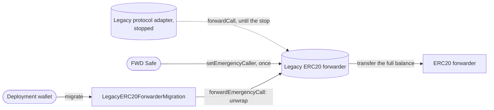
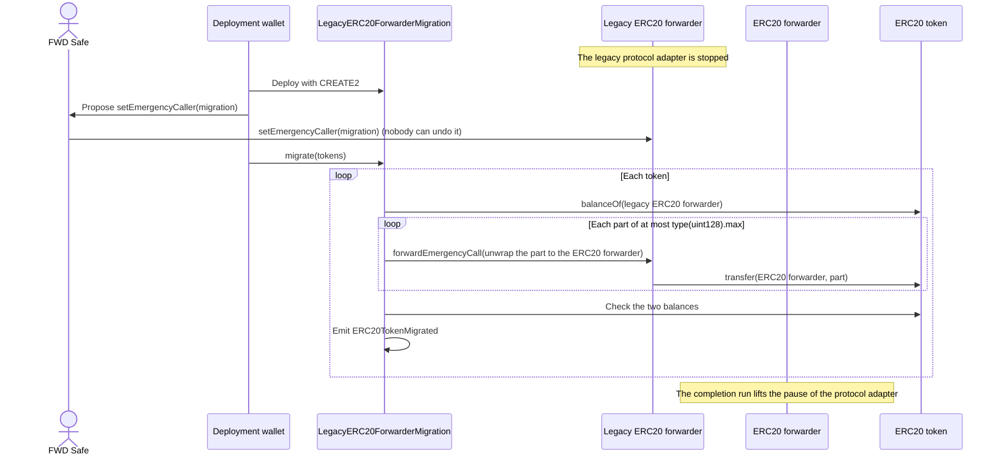

# Asset Migration — Specification & Architecture

This document specifies the asset migration: the one-time move of the tokens of a legacy ERC20 forwarder to the ERC20 forwarder. It gives the steps and the reasons for their order. The asset migration is one part of the Galileo upgrade. The pa-evm [overview](https://github.com/anoma/pa-evm/blob/next/docs/00-galileo-upgrade.md) explains the terms and the other parts. [`MIGRATION_CHECKLIST.md`](../MIGRATION_CHECKLIST.md) has the commands.

## 1. Purpose

The legacy ERC20 forwarder holds the tokens of all legacy-forwarder resources. It accepts calls only from the legacy protocol adapter. The Galileo upgrade stops the legacy protocol adapter, and nothing lifts the stop. The protocol adapter cannot call the legacy ERC20 forwarder. So the tokens move to the ERC20 forwarder. There, the legacy-forwarder entries of the kind table let each legacy-forwarder resource convert and unwrap.

The asset migration happens at most once on each chain. After it, the legacy ERC20 forwarder keeps its emergency caller, so nobody can repeat or reverse the asset migration. After the asset migration, each change of the code of the ERC20 forwarder is an upgrade, as [`02-upgrades.md`](./02-upgrades.md) specifies. A chain without a legacy ERC20 forwarder has no asset migration.

## 2. Three types of migration

The Galileo upgrade has three types of migration. The pa-evm [overview](https://github.com/anoma/pa-evm/blob/next/docs/00-galileo-upgrade.md#4-three-types-of-migration) compares them. This document covers the asset migration.

## 3. Contracts and owners

- **Legacy ERC20 forwarder.** It accepts calls only from the legacy protocol adapter. Each call must contain the logic ref `bc123236…`, version 1.0.0. The forwarder also has two emergency functions. They let an **emergency caller** send calls after the stop of the legacy protocol adapter. Section [4](#4-the-emergency-functions-of-the-legacy-erc20-forwarder) specifies them.
- **`LegacyERC20ForwarderMigration`**, the **migration contract**. The emergency caller that moves the tokens. Section [5](#5-legacyerc20forwardermigration) specifies it.
- **ERC20 forwarder.** The upgradeable forwarder of one environment, which receives the tokens. [`02-upgrades.md`](./02-upgrades.md#1-contracts-and-owners) specifies it.

| Contract | Before the asset migration | During the asset migration | After the asset migration |
| --- | --- | --- | --- |
| Legacy ERC20 forwarder | The FWD Safe controls its emergency functions. It has no emergency caller. | The FWD Safe sets the migration contract as its emergency caller. | The emergency caller does not change. |
| Migration contract | — | The deployment wallet deploys it and owns it. | The deployment wallet owns it. |

## 4. The emergency functions of the legacy ERC20 forwarder

The legacy ERC20 forwarder has two emergency functions. Both work only while the legacy protocol adapter is stopped (`isEmergencyStopped()`).

- `setEmergencyCaller(caller)`. The FWD Safe sets the emergency caller. The function accepts one caller and keeps it. So nobody can remove or change the emergency caller.
- `forwardEmergencyCall(input)`. The emergency caller sends any input that the legacy protocol adapter can send, for example an unwrap of any amount to any receiver.

If the emergency caller is an account with a private key, the holder of that key can send the tokens to any address. So the FWD Safe sets a contract that can send them to one address only.

## 5. `LegacyERC20ForwarderMigration`

The constructor stores two addresses: the legacy ERC20 forwarder (`LEGACY_FORWARDER`) and the ERC20 forwarder of one environment (`FORWARDER`). It also sets the owner. It reverts in two cases:

- An address is zero or has no code.
- The two addresses are the same.

Only the owner can call `migrate(tokens)`. For each token in the list, the function does these steps:

1. It reads the full balance of the legacy ERC20 forwarder.
2. It calls `forwardEmergencyCall` with an unwrap of that amount to the ERC20 forwarder. The legacy ERC20 forwarder unwraps at most `type(uint128).max` in one call, so a larger balance takes more than one call.
3. It reverts if the legacy ERC20 forwarder still holds some of the token.
4. It reverts if the ERC20 forwarder did not receive exactly that amount.
5. It emits `ERC20TokenMigrated(legacyForwarder, forwarder, token, amount)`. The amount is zero if the legacy ERC20 forwarder held none of the token.

If a call did not include a token, the owner can call `migrate` again for that token. The token can still go only to the same ERC20 forwarder.

## 6. Scripts

- **`DeployLegacyERC20ForwarderMigration`** deploys the migration contract with CREATE2. So the address of the contract depends on the two forwarders and on the owner, the deployment wallet. Then the script proposes `setEmergencyCaller(migration)` to the FWD Safe. The proposal can reach the Safe service before the chain includes the deployment. It names the correct address anyway, because CREATE2 fixes the address in advance. A second run finds the deployed contract and does not deploy another one. The script refuses to run before the stop of the legacy protocol adapter. It also refuses to run if the legacy ERC20 forwarder already has an emergency caller.
- **`MigrateERC20ForwarderAssets`** calls `migrate` from the deployment wallet, and it checks the result. It reads the address of the migration contract from the emergency caller of the legacy ERC20 forwarder.

The deployment wallet signs the proposal. So it must be a signer or a delegate of the FWD Safe, because the Safe service accepts proposals only from them.

Both scripts read the two forwarders from the deployment record, through `RecordedDeployments`: a Solidity library that the build generates from the deployment record. Then the scripts check three conditions on the chain:

- The owner of the ERC20 forwarder is the owner of its environment: the deployment wallet in staging, the FWD Safe in production.
- Each forwarder accepts calls only from the protocol adapter that the deployment record of pa-evm names for it.
- The migration contract stores the addresses of the two forwarders of the record, and the deployment wallet owns it.

## 7. The list of tokens

`migrate` moves only the tokens in its list. The team reads the list from the chain. The list contains each token of the `Wrapped` events that the legacy ERC20 forwarder emitted, from its deployment block to the block of the stop. The legacy protocol adapter executes no transaction after the stop, so this list is final. The legacy ERC20 forwarder can also hold a token that no wrap brought to it. That token is not in the list, because no legacy-forwarder resource represents it.

The kind table of the chain must have legacy-forwarder entries for each token in the list. The kind tables repository writes these entries for each token that its file `tokens.json` marks with `soft_migrate_from_legacy_forwarder: true`. A wrapped token without entries gives its legacy-forwarder resources no way to unwrap. A token whose balance did not move must not have entries when the protocol adapter starts to execute transactions. Otherwise, its legacy-forwarder resources can unwrap tokens that other resources of the same token represent.

## 8. Steps

These steps are step 11 of the Galileo upgrade of a migrated chain, in pa-evm's [`01-state-migration.md`](https://github.com/anoma/pa-evm/blob/next/docs/01-state-migration.md#5-steps). They occur after the stop of the legacy protocol adapter and before the completion run. During this time, users cannot transact.

| # | Step | Signer |
| --- | --- | --- |
| 1 | Read the `Wrapped` events until the block of the stop. If a token is not in `tokens.json`, add it. The kind tables repository then makes a new kind table, and the deployment wallet sets its root on the paused protocol adapter. | Deployment wallet, for a new root |
| 2 | Simulate the deployment and the proposal. The simulation executes the Safe transaction as the FWD Safe. | — |
| 3 | Deploy the migration contract, and propose it to the FWD Safe as the emergency caller. | Deployment wallet |
| 4 | Publish the source code of the migration contract on sourcify and Etherscan, so that the signers can read it. | — |
| 5 | Set the migration contract as the emergency caller of the legacy ERC20 forwarder. Nobody can undo this step. | FWD Safe |
| 6 | Simulate the move. | — |
| 7 | Move the tokens. The move is one chain transaction, so a revert moves no token. A long list can need more gas than one chain transaction allows. Then the team splits the list into several calls. | Deployment wallet |
| 8 | Check that the legacy ERC20 forwarder holds none of the tokens in the list. | — |

The migration run of the state migration also sends its chain transactions from the deployment wallet. An account sends its chain transactions in a fixed order, so two scripts that send from the same account at the same time can conflict. So steps 3 and 7, and a new root in step 1, wait until the migration run ends. The other steps can occur during the migration run.

## 9. Reason for the order

The legacy-forwarder entries let a legacy-forwarder resource convert and unwrap from the ERC20 forwarder. Before the move, the ERC20 forwarder does not hold the tokens of these resources. So an unwrap at that time sends tokens that other resources represent. The ERC20 forwarder sends tokens only when its protocol adapter calls it. The protocol adapter stays paused from its deployment until the completion run, and the completion run starts only after the move. So no legacy-forwarder resource can unwrap before the ERC20 forwarder holds its tokens.

## 10. Staging and production

The FWD Safe sets the emergency caller in both environments, and the deployment wallet owns the migration contract in both environments. The environment variable `IS_PRODUCTION` selects the ERC20 forwarder that receives the tokens. The legacy ERC20 forwarder keeps its emergency caller, so its tokens can move to the ERC20 forwarder of only one environment. The team selects the environment before the proposal, for example staging on a test network and production on a main network.

## 11. Events

| Contract | Event | When |
| --- | --- | --- |
| ERC20 forwarder | `Wrapped(token, from, amount)` | A wrap takes tokens from a user. |
| ERC20 forwarder | `Unwrapped(token, to, amount)` | An unwrap sends tokens to a receiver. |
| Legacy ERC20 forwarder | `Unwrapped(token, to, amount)` | An unwrap, and also each move of the asset migration, with the ERC20 forwarder as `to` |
| `LegacyERC20ForwarderMigration` | `ERC20TokenMigrated(legacyForwarder, forwarder, token, amount)` | The contract moved a token, also with a zero amount. |

The ERC20 forwarder emits no event when it receives the tokens of the asset migration. An indexer that calculates the token balance of the ERC20 forwarder from `Wrapped` and `Unwrapped` events must add the amounts of the `ERC20TokenMigrated` events.

## 12. Trust assumptions

- **The protocol adapter stays paused until the move ends.** The forwarders and the migration contract do not check this. Only the order of the steps keeps the pause.
- **The FWD Safe sets the correct contract.** Nobody can undo this step. The CREATE2 address depends on the two forwarders and the owner. Before they confirm, the signers read `LEGACY_FORWARDER()`, `FORWARDER()` and `owner()` on the published contract.
- **The owner of the migration contract can move tokens only to the ERC20 forwarder.** The owner selects the tokens and the time. The owner cannot select the amount or the receiver.
- **The list of tokens is complete.** A token that is not in the list stays in the legacy ERC20 forwarder until a later `migrate` moves it. Until then, the token must not have legacy-forwarder entries.
- **No token takes a fee on a transfer.** The ERC20 forwarder must receive exactly the moved amount, or the move reverts. The legacy ERC20 forwarder checked the same condition for each wrap. But a token can start to take a fee after its wrap, for example after an upgrade of the token. Then `migrate` reverts for that token. The team moves the other tokens without it. The migration contract can move that token only when the token no longer takes the fee.
- **Each balance moves in one transaction.** The legacy ERC20 forwarder unwraps at most `type(uint128).max` in one call, so `migrate` moves a larger balance in more than one call. A balance that needs more calls than one transaction can make cannot move. Only a token with a total supply far above 2^128 units can have such a balance.

## 13. Parameters

| Name | Value | Use |
| --- | --- | --- |
| `Parameters.MIGRATION_SALT` | `"ERC20ForwarderMigration"` | CREATE2 salt of the migration contracts |
| `IS_PRODUCTION` | `true` or `false` | An environment variable of the scripts. It selects the ERC20 forwarder that receives the tokens. |

The pa-evm [overview](https://github.com/anoma/pa-evm/blob/next/docs/00-galileo-upgrade.md#accounts-and-controls) gives the addresses of the deployment wallet and the FWD Safe. The deployment record, [`crates/bindings/deployments.json`](../crates/bindings/deployments.json), lists the legacy ERC20 forwarder of each chain under `legacy`, with the logic ref that it accepts.
