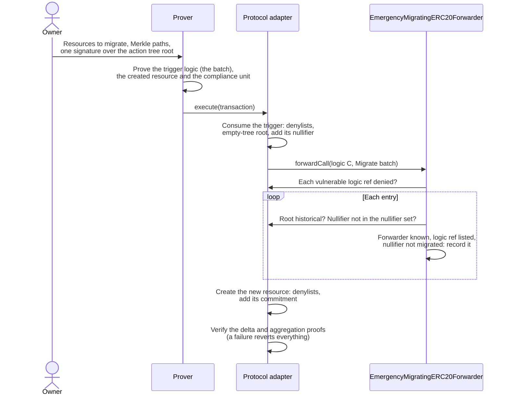

# Hard Migration — Specification & Architecture

This document specifies the hard migration of ERC20 resources: how the draft [`EmergencyMigratingERC20Forwarder`](../contracts/src/draft/EmergencyMigratingERC20Forwarder.sol) and the emergency-migrating ERC20 circuit let resource owners move their resources away from a circuit version with a flaw ([anoma/dos-pm#42](https://github.com/anoma/dos-pm/issues/42)). The contracts and the circuit crates call the hard migration *emergency migration*. The protocol adapter's part, and the comparison with the soft migration, are in pa-evm's [`02-resource-kind-migration.md`](https://github.com/anoma/pa-evm/blob/next/docs/02-resource-kind-migration.md). The domain vocabulary is in [`CONTEXT.md`](../CONTEXT.md).

## 1. Purpose

A flaw in an ERC20 transfer circuit can let false proofs pass, for example a flaw in the circuit code or in the RISC Zero version that it uses. The owner of the protocol adapter then denies the logic ref of that circuit version, so no transaction consumes or creates its resources. The resources and their tokens stay where they are, but no transaction can spend them. The hard migration lets each owner create resources of a version without the flaw, for the same quantity, from a proof that their resources exist and are unspent. No proof of the flawed circuit runs again.

The hard migration is neither the asset migration of [`01-upgrades-and-asset-migration.md`](./01-upgrades-and-asset-migration.md), which moves the tokens of the legacy ERC20 forwarder once per chain, nor the soft migration, in which owners convert their resources of a trusted, deprecated version. A hard migration moves no tokens: they stay in the forwarder.

## 2. Terms

This document uses the terms of the [glossary](../CONTEXT.md): circuit version, active version, deprecated version, vulnerable logic ref, legacy-forwarder resource, soft migration and hard migration. Two terms are only used here:

- **Trigger** — the ephemeral resource of the migrating circuit that a hard migration transaction consumes. Its logic proof proves the batch.
- **Batch** — the resources that one hard migration transaction migrates.

## 3. Cases

The examples name circuit versions with letters, in release order. Each case starts from the same state:

- **A**: a deprecated version.
- **B**: the active version.
- **C**: the version that the forwarder moves to.
- **D**: the version after C, only in [A second incident](#a-second-incident).

Legacy-forwarder resources carry the logic ref that the legacy ERC20 forwarder accepts. In the examples, that is A.

C must have no flaw, and it must have the migrate call: only a resource of a circuit with the migrate call can be the trigger of a hard migration. The active version 2.0.0-rc.1 (`51c2403f…`) has no migrate call. The emergency-migrating ERC20 circuit (`47ab0d90…`) wraps, transfers and unwraps like it and adds the migrate call. So after a flaw, the forwarder moves to the emergency-migrating circuit, or to a fixed build of it if the flaw is in code that both share.

### Voluntary upgrade

No circuit version has a flaw. C improves B.

1. The kind tables list C as the active version, and B becomes deprecated. The owner of the protocol adapter stores the new kind table root.
2. The owner of the forwarder upgrades it to an implementation that accepts the logic ref of C. The forwarder keeps its address, so the label of its resources does not change.
3. When the backend creates resources of C, the owner of the protocol adapter deprecates the logic ref of B.
4. Owners of resources of A and B, and of legacy-forwarder resources, soft-migrate them to C.

A voluntary upgrade needs no hard migration. `ERC20Forwarder` has no function that sets a new logic ref yet; the release that ships C adds one. After an incident, every later implementation must keep the hard migration, because the resources with a listed logic ref have no other way out. A voluntary upgrade then uses an emergency-migrating implementation that has such a function, because `reinitialize` must list at least one vulnerable logic ref.

### Upgrade after a flaw

Each incident follows these steps:

1. The owner of the protocol adapter pauses it. The protocol adapter then executes no transaction.
2. The owner of the protocol adapter denies each vulnerable logic ref with `denyLogicRefs`: it adds the logic ref to both denylists.
3. The owner of the forwarder upgrades it to `EmergencyMigratingERC20Forwarder` and, in the same call, calls `reinitialize` with the logic ref of C and the vulnerable logic refs to list (see [Which resources can hard-migrate](#7-which-resources-can-hard-migrate)).
4. The kind tables list C as the active version. They keep a vulnerable version listed as deprecated, but no transaction can use its rows, because the protocol adapter denies its logic ref. The owner of the protocol adapter stores the new kind table root. If B has no flaw, the owner deprecates its logic ref.
5. The owner of the protocol adapter lifts the pause.
6. Resource owners hard-migrate their resources with a vulnerable logic ref, and soft-migrate their resources of a deprecated version.

The cases differ in the circuit versions with the flaw:

| Flaw in | C | The protocol adapter denies | `reinitialize` lists | Soft migration | Hard migration |
| --- | --- | --- | --- | --- | --- |
| B, the active version | fixes B | B | B | A and legacy-forwarder resources | B |
| A, a deprecated version | adds the migrate call to B | A | A | B | A and legacy-forwarder resources |
| A and B, for example through a RISC Zero version that both use | fixes A and B | A and B | A and B | none | A, B and legacy-forwarder resources |

If more deprecated versions have the flaw, the protocol adapter denies each of them, and `reinitialize` lists them too.

### A second incident

After an incident, C is active and has the migrate call. `reinitialize` runs only once per implementation, so each later incident needs an upgrade to a new implementation of the forwarder. If a later flaw is in C, the owner follows the steps above with D, which fixes C. If a later flaw is only in a deprecated version, for example A, C stays active: the owner upgrades the forwarder and calls `reinitialize` with the logic ref of C and the list with A. `reinitialize` can keep the logic ref. The logic refs of the first incident stay listed, so their resources can still hard-migrate to the active version.

### Flaws that the forwarder cannot handle

- **A flaw in the RISC Zero verifier or in the compliance circuit.** It lets false proofs pass for every circuit. The owner of the protocol adapter upgrades the protocol adapter to an implementation without the flaw. A hard migration does not help. If the flaw is in a RISC Zero version that circuit versions of the forwarder also use, the owner also follows the steps above.
- **A flaw in the circuit of another application.** The owner of that application handles it. This forwarder must not list its logic ref (see [Which resources can hard-migrate](#7-which-resources-can-hard-migrate)).

## 4. The forwarder

`EmergencyMigratingERC20Forwarder` is an `ERC20Forwarder` with a third call type. `Wrap` and `Unwrap` keep their values and work as before, and `Migrate` hard-migrates a batch.



### `reinitialize`

`reinitialize(newLogicRef, vulnerableLogicRefs)` is owner-only and runs once per implementation (`reinitializer(2)`). It reverts unless:

- the new logic ref is not zero and the protocol adapter denies it on neither denylist,
- the list has at least one logic ref,
- the protocol adapter denies each listed logic ref on both denylists,
- no logic ref is listed twice.

It emits `VulnerableLogicRefListed` for each listed logic ref and, if the new logic ref differs from the accepted one, replaces it and emits `LogicRefReplaced`. No function removes a listed logic ref. `isLogicRefVulnerable` and `isNullifierMigrated` read the list and the recorded nullifiers, which the contract keeps in the ERC-7201 namespace `anoma.storage.EmergencyMigratingERC20Forwarder`.

### The `Migrate` call

The trigger calls the forwarder with the ABI encoding of `(EmergencyMigratingCallType.Migrate, IERC20 token, uint128 quantity, MigrateEntry[] entries)`, where `quantity` is the total quantity of the batch and each entry is:

```solidity
struct MigrateEntry {
    bytes32 nullifier; // The nullifier of the resource.
    bytes32 commitmentTreeRoot; // The commitment tree root that the resource is proven against.
    bytes32 vulnerableLogicRef; // The logic ref of the resource.
    address forwarder; // The forwarder address in the resource label.
}
```

The forwarder reverts on an empty batch and on an input of the wrong length. Before it reads the first entry, it checks that both denylists of the protocol adapter still contain every vulnerable logic ref that it lists. Then, for each entry, it checks that:

- the forwarder address in the resource label is this forwarder or the legacy ERC20 forwarder of the chain,
- the forwarder lists the logic ref as vulnerable,
- the root is a historical root of the protocol adapter,
- the nullifier set of the protocol adapter does not contain the nullifier,
- the forwarder did not migrate the resource before.

The forwarder records each nullifier before it reads the next entry, so a batch that contains one resource twice reverts. It emits `Migrated(token, vulnerableLogicRef, nullifier)` for each entry. A hard migration moves no tokens, so an indexer that adds up the `Wrapped` and `Unwrapped` amounts must not count it as a deposit.

## 5. The circuit

The emergency-migrating ERC20 circuit lives in [anoma/anomapay-erc20-resource](https://github.com/anoma/anomapay-erc20-resource), in the crates `anomapay_emergency_migrating_erc20_witness` and `anomapay_emergency_migrating_erc20_library`, version 2.0.0-rc.1. Its logic ref is `47ab0d901b35909c87c6c08463393205ae42f11ca4af3dd48416606bb02fbcc2`.

A hard migration transaction consumes the trigger and creates resources of the migrating circuit, under the label of this forwarder and the token, for the total quantity of the batch. The resources of the batch are not part of the transaction: the protocol adapter does not consume them, and they do not enter the delta. The trigger and the created resources balance, because they have one kind and the same quantity.

**The trigger** is an ephemeral, consumed resource of the migrating circuit. The resource machine requires the logic proof of a resource to be made with the circuit that its logic ref names, so only this circuit can prove the trigger. Its label is the hash of the forwarder address and the token address, and its quantity is the total quantity of the batch. Like every ephemeral resource, it proves membership against the empty-tree root.

**For each entry**, the logic proof of the trigger:

1. computes the commitment of the resource and, from its Merkle path, the root of the commitment tree,
2. requires the resource to be persistent,
3. requires its value ref to match the keys of its owner,
4. requires the same authorization key as the first entry,
5. computes its nullifier from its nullifier key, which must match the nullifier key commitment of the resource; this is the nullifier that the protocol adapter would record if it consumed the resource,
6. requires its label to be the hash of the forwarder address of the entry and the token of the trigger, so a batch has one token,
7. adds its quantity to the total, and reverts on an overflow.

**For the batch**, it then requires:

- at least one entry,
- the total quantity to equal the quantity of the trigger,
- one signature over the action tree root with the shared authorization key, in the domain `TokenTransferAuthorizationEmergencyMigrating`. The action tree contains the commitments of the created resources, so the signature also authorizes who receives them.

The proof emits one forwarder call to the forwarder in the label of the trigger, with the input of [The `Migrate` call](#the-migrate-call). Each entry carries the computed nullifier and root, the logic ref of the resource and the forwarder address of its label, in the order of the witness.

**What the forwarder checks instead.** The circuit does not compare the computed root with anything, does not check the logic ref of an entry, and accepts any forwarder address in a label. The forwarder checks that the root is historical, that the logic ref is listed, and that the forwarder address is known. The forwarder does not check quantities. The circuit checks them.

**Batch size.** Neither the circuit nor the forwarder limits the number of entries. The gas limit of a transaction and the time to prove the batch limit it.

## 6. Why any historical root works

The root check ties the resource to the commitment tree of the protocol adapter. Without it, a prover could build a Merkle tree around a resource that never existed. Any historical root of the protocol adapter is enough, and the forwarder stores no root of its own:

- After the denial, no transaction can create a resource with the vulnerable logic ref, so no root contains one that an earlier root does not.
- The nullifier checks stop a second use of a resource, whichever root its proof uses.

The prover can therefore prove against the latest root of the protocol adapter.

## 7. Which resources can hard-migrate

The forwarder keeps its address when it is upgraded, so the label of its resources is the same for every circuit version. The logic ref is different, and it is part of the kind of a resource.

The forwarder must hard-migrate only resources whose tokens it holds, not every resource whose logic ref the protocol adapter denies. So an entry must meet two conditions:

- **The label names this forwarder or the legacy ERC20 forwarder of the chain.** Anyone can deploy a contract that acts as a forwarder, and a resource with that contract in its label can have any quantity. The forwarder holds the tokens of its own resources and of the legacy-forwarder resources, because the asset migration moved the balances of the legacy ERC20 forwarder to it. The implementation takes the legacy ERC20 forwarder as a constructor argument, or the zero address on a chain without one. The script that deploys the implementation must take the address from the deployment record, `RecordedDeployments.legacyForwarder`, which returns the zero address for such a chain.
- **The forwarder lists the logic ref.** `reinitialize` adds the logic refs that the owner passes, and nothing removes them. The owner must list only circuit versions of this forwarder and the logic ref of the legacy ERC20 forwarder. All applications share the denylists: a resource with the denied logic ref of another application can have the label of this forwarder and any quantity, and a hard migration of it would create ERC20 resources for tokens that the forwarder does not hold.

A legacy-forwarder resource needs no check of its logic ref. A resource with the legacy ERC20 forwarder in its label reaches the protocol adapter only through the copy-in of the state of the legacy protocol adapter, or through a kind table alias until the protocol adapter deprecates the logic ref of the legacy ERC20 forwarder. Both carry that logic ref. Any other legacy-forwarder resource needs a flaw, and the same flaw could create resources with the label of this forwarder too. The owner of the protocol adapter deprecates the logic ref of the legacy ERC20 forwarder before the completion run lifts the pause, so that no transaction creates legacy-forwarder resources.

The forwarder does not check tokens. The owner lists the logic ref of the legacy ERC20 forwarder only if the balances of all tokens that the legacy ERC20 forwarder wrapped moved to this forwarder. The asset migration requires this before the protocol adapter lifts its pause.

## 8. Why the protocol adapter must deny the vulnerable logic ref

A hard migration does not consume the resource at the protocol adapter; the forwarder records its nullifier. Without the entry in the denylist for consumed resources, the owner could also consume the resource at the protocol adapter, for example to soft-migrate it. A transaction that uses the flaw could also add the nullifier of the resource of another owner to the nullifier set of the protocol adapter, and that resource could then not hard-migrate. Without the entry in the denylist for created resources, a transaction that uses the flaw could still create resources with the vulnerable logic ref, and these resources could hard-migrate too. So the logic ref must be on both denylists: a deprecation, which adds it to the denylist for created resources only, is not enough. The protocol adapter has no function that removes a denylist entry. If an upgrade of the protocol adapter removes one, every hard migration reverts until the owner denies the logic ref again.

## 9. Limits

- **The forwarder does not check amounts.** The tokens stay in the forwarder, so the balance check of wrap and unwrap cannot check a hard migration. The circuit must make sure that the created resources match the migrated resources: the same token, the total quantity, and the signature of the owner over the action tree root. If the circuit does not check this, a hard migration can create resources for tokens that the forwarder does not hold.
- **The owner chooses the list.** The forwarder cannot check on chain that it holds the tokens of the resources with a listed logic ref, and no function removes a listed logic ref (see [Which resources can hard-migrate](#7-which-resources-can-hard-migrate)).
- **One owner and one token per batch.** All entries share one authorization key and one token. An owner with resources of several tokens sends one batch per token.
- **Resources that an attacker created or stole can hard-migrate.** Nobody can tell them from correct resources: resources are private, and a transaction that uses the flaw looks correct on chain. An earlier root would exclude them, but it needs the start of the attack, which is usually unknown, and it would also block every correct resource created after that root. Because nobody can tell the blocked resources apart, their tokens could not be returned fairly either.
- **A soft migration carries a flaw into the active version.** Until the protocol adapter denies a deprecated version with a flaw, resources that an attacker created or stole with the flaw can soft-migrate to the active version. Nobody can tell them from correct resources of the active version.
- **Withdrawn tokens are not replaced.** If someone used the flaw to unwrap tokens, the forwarder holds fewer tokens than the resources represent. Unwraps then succeed in the order in which they execute, until the forwarder does not hold enough tokens, and the unwraps after that revert.
- **Consumed resources cannot hard-migrate.** A resource whose nullifier is in the nullifier set of the protocol adapter cannot hard-migrate. This includes resources whose nullifier an attacker added with the flaw.

## 10. Status of the draft

- The forwarder is a draft in `contracts/src/draft`. No script deploys it, and no environment runs it.
- The reinitializer version of each implementation must be one more than the initialized version of the forwarder when the upgrade starts. The draft uses 2, because `ERC20Forwarder.initialize` sets 1. `reinitialize` is owner-only: if an upgrade does not call it in the same call, nobody else can choose the logic ref and the list.
- The constructor accepts the zero address as the legacy ERC20 forwarder, for a chain without one. On a chain with a legacy ERC20 forwarder, the zero address makes the forwarder reject the hard migration of every legacy-forwarder resource. An upgrade to an implementation with the right address fixes this, and it needs no `reinitialize` call.
- The contract declares no initializer of its own. `ERC20Forwarder.initialize` initializes every parent contract, and `reinitialize` must not run it again, so it calls no parent initializer.
- The contract reports the `VERSION` of `ERC20Forwarder`, because a constant cannot be overridden. Before the draft becomes a release, `VERSION` must become a virtual getter.
- The kind tables do not list the emergency-migrating circuit yet. Its kinds have no rows, so the compliance circuit computes their kind points.
