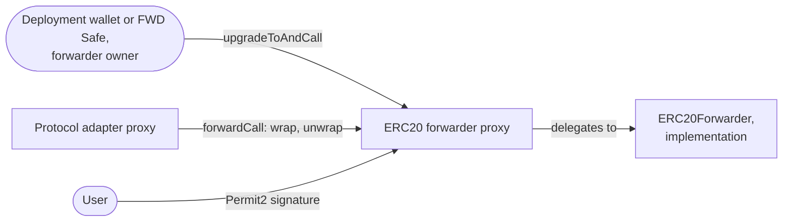

# Upgrades — Specification & Architecture

This document specifies how the ERC20 forwarder changes after its deployment: the upgrades of its implementation in the staging and the production environment, and the forced upgrades that answer a flaw. A chain that ran a legacy ERC20 forwarder first moves its tokens once, in the asset migration of [`01-asset-migration.md`](./01-asset-migration.md), and after that its ERC20 forwarder changes only by the upgrades of this document. The domain vocabulary is in [`CONTEXT.md`](../CONTEXT.md), and the commands are in [`RELEASE_CHECKLIST.md`](../RELEASE_CHECKLIST.md). The upgrades of the protocol adapter are in pa-evm's [`02-upgrades.md`](https://github.com/anoma/pa-evm/blob/next/docs/02-upgrades.md).

## 1. Contracts and owners

- **ERC20 forwarder.** An ERC-1967 proxy that delegates every call to its implementation, `ERC20Forwarder`, and upgrades with UUPS. It is initialized with the protocol adapter of the same environment, the logic ref that it accepts, and its owner. `forwardCall(logicRef, input)` accepts calls only from its protocol adapter and only with the accepted logic ref (`getLogicRef()`). A wrap pulls tokens from the user with Permit2, and the signed witness is the action tree root. An unwrap transfers tokens to a receiver. Both revert unless the balance of the forwarder changes by exactly the amount. The label ref of its resources is the hash of its address and the token address, so an upgrade keeps the label.
- **Implementation.** `ERC20Forwarder`. Its bytecode fixes `VERSION`. Both environments deploy it with one CREATE2 salt, so they share the implementation of each version.

| Environment | Owner of the ERC20 forwarder | How the owner acts | Branch |
| --- | --- | --- | --- |
| Staging | the deployment wallet `0x61462bE56782568376f9cB069382EFa72764a407` | sends each transaction directly | `staging` |
| Production | the FWD Safe `0xc703402252Ce1251aa07e0815D50060d27fdd6C4`, a Safe multisig that needs 3 of its 5 owners to confirm a transaction | a script proposes the transaction, and the Safe owners confirm and execute it in the Safe app | `main` |

## 2. Environments and promotion

Changes go in one direction: `next` → `staging` → `main`. The promotion pull request into `staging` passes only if every staging proxy runs the implementation that the source predicts. The one into `main` passes only if every production proxy runs it, its version has no prerelease suffix, and a Safe owns the proxy. So a deployment follows the merge into `next`, and the promotion pull request proves that the environment runs the merged source.

`VERSION` is a constant in the bytecode, so each version is a different implementation at a different address, and the release version runs in staging before it runs in production.

## 3. Upgrades

An upgrade replaces the implementation. It keeps the proxy address and the tokens, and it keeps the protocol adapter and the accepted logic ref unless a reinitializer of the new implementation changes them. The address stays, so the label of the resources stays, and every resource of the forwarder stays backed by the tokens that it holds.

The accepted logic ref changes only through a reinitializer, because `ERC20Forwarder` has no function that sets it. A circuit release therefore upgrades the forwarder to an implementation whose reinitializer sets the new logic ref. After that upgrade, the forwarder rejects calls from resources of the old logic ref (`LogicRefMismatch`), so the backend creates resources of the new circuit version from the same moment. Resources of the old version leave by a soft migration, which pa-evm's [`03-resource-kind-migration.md`](https://github.com/anoma/pa-evm/blob/next/docs/03-resource-kind-migration.md#4-soft-migration) specifies.

### Steps

| Step | Staging | Production |
| --- | --- | --- |
| Deploy the implementation and verify it on sourcify and Etherscan | `contracts-deploy-impl`, `contracts-verify-impl` | the same, unless staging deployed it on that chain already |
| Upgrade each proxy | the deployment wallet executes `contracts-execute-staging-upgrade` | `contracts-propose-production-upgrade` proposes the upgrade to the FWD Safe, and its owners confirm and execute it |
| Check each proxy | `getImplementation()` returns the new implementation | the same, after the Safe owners executed |
| Promote | `next` → `staging` | `staging` → `main` |
| Tag and publish | `contracts/vX.Y.Z-rc.N` and `bindings/vA.0.0-rc.N` | `contracts/vX.Y.Z` and `bindings/vA.0.0` |

Each recipe that sends a transaction has a simulation recipe, which runs first. The FWD Safe owners execute chain by chain, so a production rollout can take days. The promotion into `main` stays red until the last chain runs the new implementation.

## 4. Forced upgrades

A forced upgrade answers a flaw, and the flaw decides when it happens. The forwarder acts only on calls from its protocol adapter, so the pause of the protocol adapter stops the forwarder too. Every response therefore starts with the pause.

| Flaw in | Response |
| --- | --- |
| The code of the ERC20 forwarder | The owner of the protocol adapter pauses it. The owner of the forwarder upgrades the forwarder. The owner of the protocol adapter lifts the pause. |
| A version of the ERC20 transfer circuit | The owner of the protocol adapter pauses it and denies the logic ref. The owner of the forwarder upgrades it to `EmergencyMigratingERC20Forwarder`, so that resource owners can hard-migrate their resources. The owner of the protocol adapter lifts the pause. See [`03-hard-migration.md`](./03-hard-migration.md#upgrade-after-a-flaw). |
| The protocol adapter, its circuits or the RISC Zero verifier | The owner of the protocol adapter upgrades it, as pa-evm's [`02-upgrades.md`](https://github.com/anoma/pa-evm/blob/next/docs/02-upgrades.md#5-forced-upgrades) specifies. If the flaw is in a RISC Zero version that circuit versions of the forwarder also use, the response to a flawed circuit version applies too. |

In production, the owner of the protocol adapter is the PA Safe, and the owner of the forwarder is the FWD Safe. Each needs 3 of its 5 owners to confirm a transaction.

## 5. Trust assumptions

- **The owner of the ERC20 forwarder controls its tokens.** An upgrade replaces all code, so the owner can change how the tokens leave. In production, this relies on 3 of the 5 owners of the FWD Safe.
- **A response to a flaw in the forwarder waits for two Safes.** In production, the PA Safe pauses the protocol adapter and the FWD Safe upgrades the forwarder.

## 6. Parameters

| Name | Value | Used for |
| --- | --- | --- |
| `Parameters.DEPLOYMENT_WALLET` | `0x61462bE56782568376f9cB069382EFa72764a407` | Owner of the staging proxies |
| `Parameters.FWD_MULTISIG`, the FWD Safe | `0xc703402252Ce1251aa07e0815D50060d27fdd6C4`, 3 of 5 | Owner of the production proxies |
| `Parameters.PROXY_SALT_STAGING` | `"ERC20ForwarderProxyStaging"` | CREATE2 salt of the staging proxies |
| `Parameters.PROXY_SALT_PRODUCTION` | `"ERC20ForwarderProxyProduction"` | CREATE2 salt of the production proxies |
| `Parameters.IMPLEMENTATION_SALT` | `"ERC20ForwarderImpl"` | CREATE2 salt of the implementations, in both environments |
| `Parameters.LOGIC_REF` | `0x51c2403f4e1de40c3c3ecef69385f8772ee99b4a610e88f1ad2b1b85b481a7f2` | The logic ref of circuit version 2.0.0-rc.1, which the proxies are initialized with |

[`crates/bindings/deployments.json`](../crates/bindings/deployments.json) records the proxies of each environment.
