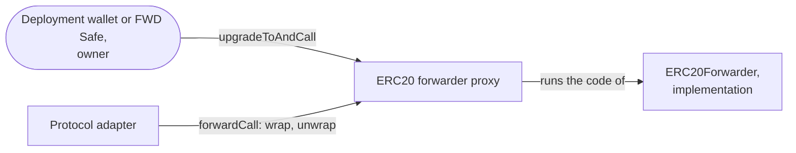

# ERC20 Forwarder Upgrades — Specification & Architecture

This document specifies how the ERC20 forwarder changes after its deployment. It includes the upgrades in the staging and the production environment, and the response to a flaw. On a chain with a legacy ERC20 forwarder, the tokens first move once, as [`01-asset-migration.md`](./01-asset-migration.md) specifies. After that, the ERC20 forwarder changes only as this document specifies. The pa-evm [overview](https://github.com/anoma/pa-evm/blob/next/docs/00-galileo-upgrade.md) explains the terms. [`RELEASE_CHECKLIST.md`](../RELEASE_CHECKLIST.md) has the commands.

## 1. Contracts and owners

The ERC20 forwarder is an ERC-1967 proxy in the UUPS pattern. Its implementation is `ERC20Forwarder`. At its deployment, the proxy gets three values: the protocol adapter of the same environment, the logic ref that it accepts, and its owner.

- **Calls.** `forwardCall(logicRef, input)` accepts calls only from the protocol adapter, and only with the accepted logic ref (`getLogicRef()`).
- **Wrap.** A wrap takes tokens from the user through Permit2, a contract of Uniswap. The user signs the transfer, and the signature also covers the action tree root.
- **Unwrap.** An unwrap sends tokens to a receiver.
- **Balance check.** A wrap and an unwrap revert if the balance of the forwarder does not change by exactly the amount.
- **Label ref.** The label ref of its resources is the hash of its address and the token address. An upgrade keeps the address, so it also keeps the label refs.

| Environment | Owner | How the owner acts | Branch |
| --- | --- | --- | --- |
| Staging | The deployment wallet | It sends each chain transaction directly. | `staging` |
| Production | The FWD Safe | A script proposes the Safe transaction. Then the signers confirm and execute it in the Safe app. | `main` |

## 2. Upgrades

An upgrade replaces the implementation. It keeps the address and the tokens. It also keeps the protocol adapter and the accepted logic ref, unless the new implementation changes them in a reinitializer. A reinitializer is a function that runs only once for each implementation. The owner calls it in the same chain transaction as the upgrade.

The release process is the process of the protocol adapter, which pa-evm's [`02-upgrades.md`](https://github.com/anoma/pa-evm/blob/next/docs/02-upgrades.md#2-environments-and-promotion) specifies. There is one difference: the FWD Safe owns the production ERC20 forwarders, not the PA Safe. So the FWD Safe signers confirm the production upgrades.

**A new logic ref.** `ERC20Forwarder` has no function that sets the accepted logic ref. So the release of the next version of the ERC20 resource logic must add one, for example a reinitializer. After the upgrade, the forwarder rejects calls with the old logic ref (`LogicRefMismatch`). So the AnomaPay backend starts to create resources of the new version at the same time. Users then replace the resources of the old version in a soft migration, which pa-evm's [`03-resource-kind-migration.md`](https://github.com/anoma/pa-evm/blob/next/docs/03-resource-kind-migration.md#case-1-a-circuit-release) specifies.

## 3. Response to a flaw

The ERC20 forwarder acts only when the protocol adapter calls it. So the ERC20 forwarder does nothing while the protocol adapter is paused. Each response to a flaw therefore starts with a pause of the protocol adapter.

| Flaw in | Response |
| --- | --- |
| The code of the ERC20 forwarder | The owner of the protocol adapter pauses it. The owner of the ERC20 forwarder upgrades it. The owner of the protocol adapter lifts the pause. |
| A version of the ERC20 resource logic | A hard migration. [`03-hard-migration.md`](./03-hard-migration.md#upgrade-after-a-flaw) gives the steps. |
| The protocol adapter, its circuits or the RISC Zero verifier | An upgrade of the protocol adapter, as pa-evm's [`02-upgrades.md`](https://github.com/anoma/pa-evm/blob/next/docs/02-upgrades.md#5-response-to-a-flaw) specifies. Versions of the ERC20 resource logic that use the flawed RISC Zero version also need a hard migration. |

## 4. Trust assumptions

- **The owner of the ERC20 forwarder controls its tokens.** An upgrade replaces all code. So the owner can change how tokens leave the forwarder. In production, the FWD Safe signers decide each upgrade.
- **A response to a flaw in the forwarder needs two Safes.** In production, the PA Safe pauses the protocol adapter, and the FWD Safe upgrades the ERC20 forwarder.

## 5. Parameters

| Name | Value | Use |
| --- | --- | --- |
| `Parameters.PROXY_SALT_STAGING` | `"ERC20ForwarderProxyStaging"` | CREATE2 salt of the staging ERC20 forwarders |
| `Parameters.PROXY_SALT_PRODUCTION` | `"ERC20ForwarderProxyProduction"` | CREATE2 salt of the production ERC20 forwarders |
| `Parameters.IMPLEMENTATION_SALT` | `"ERC20ForwarderImpl"` | CREATE2 salt of the implementations, in both environments |
| `Parameters.LOGIC_REF` | `0x51c2403f4e1de40c3c3ecef69385f8772ee99b4a610e88f1ad2b1b85b481a7f2` | Logic ref of version 2.0.0-rc.1, which the ERC20 forwarders accept at their deployment |

The pa-evm [overview](https://github.com/anoma/pa-evm/blob/next/docs/00-galileo-upgrade.md#accounts-and-controls) gives the addresses of the deployment wallet and the FWD Safe. The deployment record, [`crates/bindings/deployments.json`](../crates/bindings/deployments.json), lists the ERC20 forwarders of each environment.
