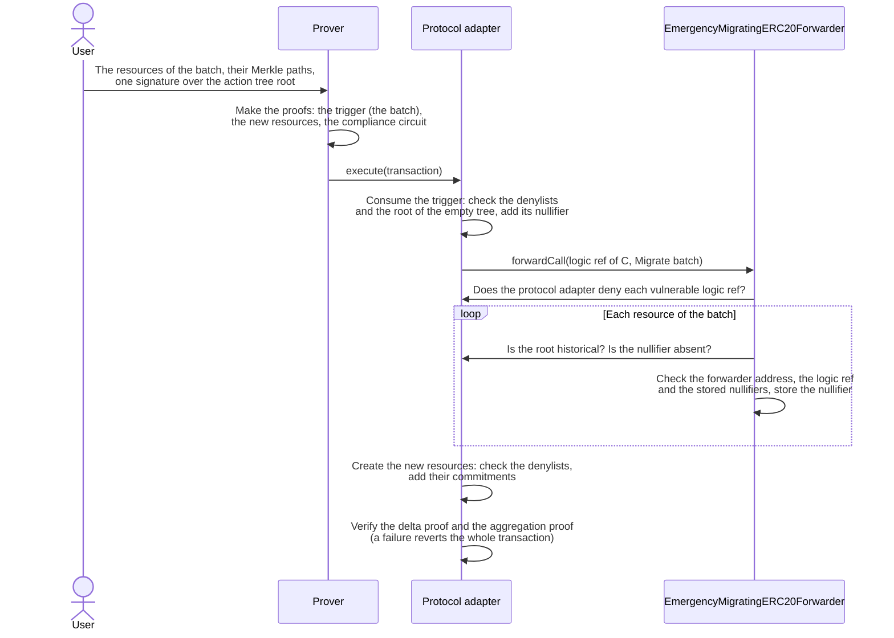

# Hard Migration — Specification & Architecture

This document specifies the hard migration of ERC20 resources. It uses two drafts: the forwarder implementation [`EmergencyMigratingERC20Forwarder`](../contracts/src/draft/EmergencyMigratingERC20Forwarder.sol) and the emergency-migrating ERC20 circuit. The code calls the hard migration emergency migration. pa-evm's [`03-resource-kind-migration.md`](https://github.com/anoma/pa-evm/blob/next/docs/03-resource-kind-migration.md#5-hard-migration) explains the hard migration for all applications and compares it with the soft migration. The pa-evm [overview](https://github.com/anoma/pa-evm/blob/next/docs/00-galileo-upgrade.md) explains the terms. The issue [anoma/dos-pm#42](https://github.com/anoma/dos-pm/issues/42) of the team tracks the work.

## 1. Purpose

A flaw in a version of the ERC20 resource logic can let the protocol adapter accept false proofs. The flaw can be in the circuit code, or in the RISC Zero version that the circuit uses. Then the owner of the protocol adapter denies the logic ref of that version. After the denial, no transaction can consume or create its resources. The tokens stay in the ERC20 forwarder, and the resources stay in the commitment tree, but nobody can use the resources.

The hard migration lets each user create resources of a version without the flaw, for the same quantity. The user proves that their old resources exist and are unspent. The protocol adapter verifies no more proofs of the flawed version. A hard migration moves no tokens.

## 2. Terms

This document uses these terms. The glossary of this repository, the file [`CONTEXT.md`](../CONTEXT.md), also defines the first three.

- **Deprecated version.** A version of the ERC20 resource logic whose logic ref the owner of the protocol adapter deprecated. Transactions can consume its resources, but no transaction can create them.
- **Vulnerable logic ref.** The logic ref of a version with a flaw. The owner of the protocol adapter denies it, and the forwarder lists it.
- **Legacy-forwarder resource.** As the overview defines. These resources have the logic ref of version A below, but the label ref of the legacy ERC20 forwarder. So the tables below name them separately from the resources of version A.
- **Migrate call.** The call type `Migrate` of the forwarder. Only a circuit with the matching code can make this call.
- **Trigger.** The ephemeral resource that a hard migration transaction consumes. Its resource logic proof checks the batch.
- **Batch.** The resources that one hard migration transaction replaces.

The examples name versions of the ERC20 resource logic with letters, in the order of their release:

- **A**: a deprecated version.
- **B**: the active version.
- **C**: the version that the forwarder accepts after the change.
- **D**: the version after C, only in [A second flaw](#a-second-flaw).

## 3. Cases

Version C must have no flaw, and it must have the migrate call. The active version 2.0.0-rc.1 (`51c2403f…`) has no migrate call. The emergency-migrating ERC20 circuit (`47ab0d90…`) wraps, transfers and unwraps like it, and it adds the migrate call. So after a flaw, the forwarder accepts the logic ref of the emergency-migrating circuit. If the flaw is in code that both circuits share, the forwarder accepts the logic ref of a corrected build of the emergency-migrating circuit.

### A release without a flaw

No version has a flaw, and C improves B. This is a soft migration, which pa-evm's [`03-resource-kind-migration.md`](https://github.com/anoma/pa-evm/blob/next/docs/03-resource-kind-migration.md#case-1-a-circuit-release) specifies. It needs no hard migration. Two facts are specific to the forwarder:

- `ERC20Forwarder` has no function that sets the accepted logic ref. So the release of the next version must add one, for example a reinitializer.
- After a hard migration, each later implementation must keep the migrate call. The resources with a listed logic ref have no other way to unwrap. `reinitialize` must list at least one vulnerable logic ref. So a later release without a flaw needs another function that sets the accepted logic ref.

### Upgrade after a flaw

After each flaw, the team does these steps:

1. The owner of the protocol adapter pauses it. The protocol adapter then executes no transaction.
2. The owner of the protocol adapter denies each vulnerable logic ref with `denyLogicRefs`. So each vulnerable logic ref is on both denylists.
3. The owner of the forwarder upgrades it to `EmergencyMigratingERC20Forwarder`. In the same chain transaction, the owner calls `reinitialize` with the logic ref of C and the list of vulnerable logic refs. Section [6](#6-which-resources-can-hard-migrate) states which logic refs the list can contain.
4. The kind tables repository lists C as the active version. Each kind of a version without the flaw gets a new kind point. It is the kind point of the kind of C with the same token and the label ref of the ERC20 forwarder. This includes the kinds of the legacy-forwarder resources, if their version has no flaw. The kind tables keep each vulnerable version in their list, but no transaction can use its entries, because the protocol adapter denies its logic ref.
5. The owner of the protocol adapter sets the new kind tree root. If B has no flaw, the owner also deprecates the logic ref of B.
6. The owner of the protocol adapter lifts the pause.
7. Users hard-migrate their resources with a vulnerable logic ref. They soft-migrate their resources of a deprecated version without the flaw.

`reinitialize` checks that the protocol adapter denies each listed logic ref on both denylists, and the logic ref of C on neither.

The cases differ in the versions with the flaw:

| Flaw in | Version C | The owner of the protocol adapter denies | `reinitialize` lists | Users soft-migrate | Users hard-migrate |
| --- | --- | --- | --- | --- | --- |
| B, the active version | A corrected B | B | B | A and the legacy-forwarder resources | B |
| A, a deprecated version | B with the migrate call | A | A | B | A and the legacy-forwarder resources |
| A and B, for example through a RISC Zero version that both use | A replacement of A and B | A and B | A and B | None | A, B and the legacy-forwarder resources |

If more deprecated versions have the flaw, the owner of the protocol adapter denies each of them, and `reinitialize` lists them too.

### A second flaw

After a flaw, C is active and has the migrate call. `reinitialize` runs only once for each implementation. So each later flaw needs an upgrade to a new implementation of the forwarder.

- If a later flaw is in C, the team does the steps above with D, which corrects C.
- If a later flaw is only in a deprecated version, for example A, C stays active. The owner upgrades the forwarder and calls `reinitialize` with the logic ref of C and a list with A.

The logic refs of the first flaw stay in the list. So their resources can still hard-migrate to the active version.

### Flaws that the forwarder cannot handle

- **A flaw in the RISC Zero verifier, the compliance circuit or the aggregation circuit.** Such a flaw affects every transaction, not only ERC20 resources. The owner of the protocol adapter upgrades it to an implementation without the flaw, as pa-evm's [`02-upgrades.md`](https://github.com/anoma/pa-evm/blob/next/docs/02-upgrades.md#5-response-to-a-flaw) specifies. A hard migration does not help. If the flaw is in a RISC Zero version that versions of the ERC20 resource logic also use, the team also does the steps above.
- **A flaw in the resource logic of another application.** The owner of that application handles it. This forwarder must not list its logic ref, as section [6](#6-which-resources-can-hard-migrate) explains.

## 4. The forwarder

`EmergencyMigratingERC20Forwarder` is an `ERC20Forwarder` with a third call type. The call types `Wrap` and `Unwrap` keep their values and work as before. The call type `Migrate` hard-migrates a batch.



### `reinitialize`

Only the owner can call `reinitialize(newLogicRef, vulnerableLogicRefs)`. It runs only once for each implementation (`reinitializer(2)`). It reverts unless these conditions are true:

- The new logic ref is not zero, and the protocol adapter denies it on neither denylist.
- The list contains at least one logic ref.
- The protocol adapter denies each listed logic ref on both denylists.
- The list contains no logic ref twice.

It emits `VulnerableLogicRefListed` for each listed logic ref. If the new logic ref is different from the accepted logic ref, it replaces the accepted logic ref and emits `LogicRefReplaced`. No function removes a listed logic ref.

`isLogicRefVulnerable` returns whether the list contains a logic ref. `isNullifierMigrated` returns whether the forwarder stored a nullifier. The contract keeps the list and the stored nullifiers at a fixed storage location of ERC-7201, `anoma.storage.EmergencyMigratingERC20Forwarder`. Later upgrades do not overwrite this location.

### The `Migrate` call

The proof of the trigger contains a forwarder call with the ABI encoding of `(EmergencyMigratingCallType.Migrate, IERC20 token, uint128 quantity, MigrateEntry[] entries)`. The quantity is the total quantity of the batch. Each entry is:

```solidity
struct MigrateEntry {
    bytes32 nullifier; // The nullifier of the resource.
    bytes32 commitmentTreeRoot; // The commitment tree root that the resource is proven against.
    bytes32 vulnerableLogicRef; // The logic ref of the resource.
    address forwarder; // The forwarder address in the label ref of the resource.
}
```

The forwarder reverts if the batch is empty or if the input has the wrong length. Before it reads the first entry, it checks that both denylists of the protocol adapter still contain each logic ref of its list. Then, for each entry, it checks these conditions:

- The forwarder address of the entry is this forwarder or the legacy ERC20 forwarder of the chain.
- The forwarder lists the logic ref as vulnerable.
- The root is a historical root of the protocol adapter. Any historical root works, for the reasons in pa-evm's [`03-resource-kind-migration.md`](https://github.com/anoma/pa-evm/blob/next/docs/03-resource-kind-migration.md#why-any-historical-root-works).
- The nullifier set of the protocol adapter does not contain the nullifier.
- The forwarder did not store the nullifier before.

The forwarder stores each nullifier before it reads the next entry. So a batch that contains a resource twice reverts. For each entry, the forwarder emits `Migrated(token, vulnerableLogicRef, nullifier)`. A hard migration moves no tokens. So an indexer that adds up the amounts of `Wrapped` and `Unwrapped` events must not count a hard migration as a wrap.

## 5. The circuit

The emergency-migrating ERC20 circuit is in [anoma/anomapay-erc20-resource](https://github.com/anoma/anomapay-erc20-resource). The crate `anomapay_emergency_migrating_erc20_witness` contains the circuit code. The crate `anomapay_emergency_migrating_erc20_library` contains the compiled circuit and the functions that build transactions. Both crates have the version 2.0.0-rc.1, like the active version, but the circuit is different and has its own logic ref, `47ab0d90…`.

A hard migration transaction consumes the trigger. It creates resources of the emergency-migrating circuit, with the label ref of this forwarder and the token, for the total quantity of the batch. The transaction does not consume the resources of the batch, so the delta proof does not include them. The delta proof balances the trigger against the new resources, because they have the same kind and the same total quantity.

**The trigger** is an ephemeral resource of the emergency-migrating circuit that the transaction consumes. The resource machine accepts a resource logic proof only from the circuit that the logic ref of the resource identifies. So only this circuit can prove the trigger. The label ref of the trigger is the hash of the forwarder address and the token address. Its quantity is the total quantity of the batch. Like each consumed ephemeral resource, it uses the root of the empty tree.

**For each resource of the batch**, the circuit does these steps:

1. It calculates the commitment of the resource. Then it calculates the root of the commitment tree from the commitment and the Merkle path.
2. It requires a persistent resource.
3. It requires that the value ref of the resource matches the keys of its user. The value ref is the hash of the keys of the user who owns the resource.
4. It requires that the resource has the same authorization key as the first resource of the batch. The authorization key is the key with which the user signs.
5. It calculates the nullifier with the nullifier key of the user. The nullifier key must match the nullifier key commitment that the resource contains. The protocol adapter calculates the same nullifier when it consumes the resource.
6. It requires that the label ref is the hash of the forwarder address of the entry and the token of the trigger. So a batch has only one token.
7. It adds the quantity to the total. An overflow makes the proof fail.

**For the whole batch**, the circuit requires these conditions:

- The batch contains at least one resource.
- The total quantity is equal to the quantity of the trigger.
- One signature with the shared authorization key signs the action tree root. The signature uses the domain `TokenTransferAuthorizationEmergencyMigrating`: a fixed text in the signed data, so that a signature for another purpose is not valid here. The action tree root covers the commitments of the new resources, so the signature also selects who receives them.

The proof of the trigger contains one forwarder call. The call goes to the forwarder in the label ref of the trigger, with the input of [The `Migrate` call](#the-migrate-call). Each entry contains the calculated nullifier and root, the logic ref of the resource, and the forwarder address of its label ref. The entries keep the order of the resources in the input of the proof.

**What the forwarder checks.** The circuit does not compare the calculated root with a stored root. It does not check the logic ref of a resource, and it accepts any forwarder address in a label ref. The forwarder checks these values.

**Batch size.** The circuit and the forwarder do not limit the number of resources in a batch. The gas limit of a chain transaction and the time to make the proof limit it.

## 6. Which resources can hard-migrate

The forwarder keeps its address in each upgrade, so the label ref of its resources is the same for each version. The logic ref is different, and it is part of the kind of a resource.

The forwarder must hard-migrate only resources whose tokens it holds, not every resource whose logic ref the protocol adapter denies. So an entry must meet two conditions:

- **The label ref names this forwarder or the legacy ERC20 forwarder of the chain.** Anyone can deploy a contract that acts as a forwarder. A resource with such a contract in its label ref can have any quantity. This forwarder holds the tokens of its own resources. On a migrated chain, it also holds the tokens of the legacy-forwarder resources, because the asset migration moved them to it. The implementation gets the address of the legacy ERC20 forwarder in its constructor. The deployment script must take the address from the deployment record, through `RecordedDeployments.legacyForwarder`. It returns zero for a chain without a legacy ERC20 forwarder.
- **The forwarder lists the logic ref.** `reinitialize` adds the logic refs that the owner gives, and nothing removes them. The owner must list only versions of the ERC20 resource logic and the logic ref of the legacy ERC20 forwarder. All applications share the denylists. A resource with the denied logic ref of another application can have the label ref of this forwarder and any quantity. A hard migration of such a resource creates ERC20 resources for tokens that the forwarder does not hold.

The forwarder does not check that a legacy-forwarder resource has the logic ref of the legacy ERC20 forwarder. A legacy-forwarder resource can get into the commitment tree of the protocol adapter only in two ways:

- through the copy-in of the state migration,
- through a conversion, before the owner of the protocol adapter deprecates the logic ref of the legacy ERC20 forwarder.

Both ways give the resource that logic ref. The owner deprecates that logic ref before the completion run lifts the pause, so in practice only the copy-in adds legacy-forwarder resources. Any other legacy-forwarder resource needs a flaw, and the same flaw can also create resources with the label ref of this forwarder.

The forwarder does not check tokens. So the owner lists the logic ref of the legacy ERC20 forwarder only after a complete asset migration. Then all tokens that wraps brought to the legacy ERC20 forwarder are in this forwarder. On a chain whose legacy protocol adapter still works, for example Base Sepolia in staging, no tokens moved. So the owner does not list that logic ref there.

## 7. Why the protocol adapter must deny the vulnerable logic ref

A hard migration does not consume the resource in the protocol adapter. The forwarder stores its nullifier instead. So the vulnerable logic ref must be on both denylists:

- **The list for consumed resources.** Without this entry, the user can also consume the resource through the protocol adapter, for example in a soft migration. Also, a transaction that uses the flaw can add the nullifier of the resource of another user to the nullifier set of the protocol adapter. Then that resource cannot hard-migrate.
- **The list for created resources.** Without this entry, a transaction that uses the flaw can still create resources with the vulnerable logic ref. These resources can also hard-migrate.

So a deprecation, which adds the logic ref only to the list for created resources, is not sufficient. No function of the protocol adapter removes a denylist entry. If an upgrade of the protocol adapter removes one, each hard migration reverts until the owner denies the logic ref again.

## 8. Limits

- **The forwarder does not check quantities.** The tokens stay in the forwarder, so the balance check of wrap and unwrap cannot check a hard migration. Only the circuit makes sure that the new resources match the old resources. They must have the same token and the same total quantity, and the user must sign the action tree root.
- **The owner selects the list.** The forwarder cannot check that it holds the tokens of the resources with a listed logic ref. No function removes a listed logic ref.
- **One user and one token in each batch.** All resources of a batch have one authorization key and one token. A user with resources of several tokens sends one batch for each token.
- **Forged resources can hard-migrate.** Resources that an attacker created or took with the flaw look correct. pa-evm's [`03-resource-kind-migration.md`](https://github.com/anoma/pa-evm/blob/next/docs/03-resource-kind-migration.md#correct-and-forged-resources) explains why the team cannot exclude them.
- **Unwrapped tokens are not replaced.** If an attacker used the flaw to unwrap tokens, the forwarder holds fewer tokens than the resources represent. Unwraps then succeed in the order of their execution, until the forwarder does not hold enough tokens. The unwraps after that revert.
- **Consumed resources cannot hard-migrate.** A resource whose nullifier is in the nullifier set of the protocol adapter cannot hard-migrate. This includes resources whose nullifier an attacker added with the flaw.

## 9. Status of the draft

- The forwarder is a draft in `contracts/src/draft`. No script deploys it, and no environment uses it. The kind tables do not list the emergency-migrating circuit yet. Its kinds have no entries, so the compliance circuit calculates their kind points.
- The reinitializer version of each implementation must be one more than the initialized version of the forwarder before the upgrade. The draft uses 2, because `ERC20Forwarder.initialize` sets 1.
- Only the owner can call `reinitialize`. If the owner does not call it in the upgrade transaction, the forwarder keeps the old accepted logic ref, and its list stays empty. Then each `Migrate` call reverts. Nobody else can select the logic ref and the list.
- The constructor accepts the zero address as the legacy ERC20 forwarder, for a chain without one. On a chain with a legacy ERC20 forwarder, the zero address makes the forwarder reject the hard migration of each legacy-forwarder resource. An upgrade to an implementation with the correct address repairs this, without a `reinitialize` call.
- The contract has no initializer of its own. `ERC20Forwarder.initialize` initializes each parent contract, and `reinitialize` must not run it again. So `reinitialize` calls no parent initializer.
- The contract returns the `VERSION` of `ERC20Forwarder`, because a constant cannot be overridden. Before the draft becomes a release, `VERSION` must become a function that each implementation can override.
